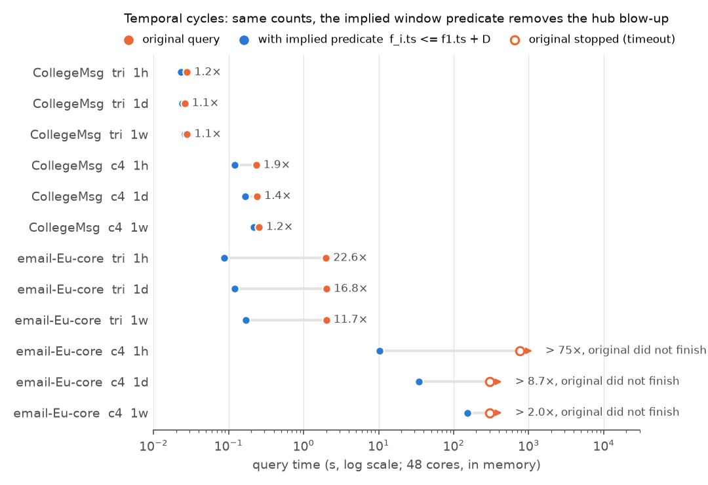

# AFR: Adaptive Fixpoint Reduction

**Verdict: AFR did not work out.** Repeating semi-join rounds past the first one doesn't pay on real graphs,
only on synthetic traps. Its one apparent win, on temporal cycles, comes from a predicate DuckDB fails to
derive. Adding that predicate by hand is exact and much faster than AFR.

## What AFR is

A *semi-join reduction* deletes rows that can't be part of any join result, before the join runs. For acyclic
joins one pass in each direction is enough (Yannakakis), and predicate transfer systems (RPT, RPT+, Parachute)
stop there. For cyclic joins, such as directed triangles, deleting rows in one copy can make rows in another
copy dead, around the loop:

```sql
SELECT count(*)
FROM edges f1 JOIN edges f2 ON f1.b = f2.a
              JOIN edges f3 ON f2.b = f3.a AND f3.b = f1.a;   -- x → y → z → x
```

AFR repeats rounds until a stopping rule says the next one isn't worth it, then runs the normal join on what's
left.

**Where it can pay:** a hub H fed by 10,000 incoming and 10,000 outgoing dead-end chains of depth d. The join
builds 10^8 two-hop paths through H, and none of them closes a triangle. Each round peels a few hops off the
chains. Once the peeling reaches H, its edges die and the blow-up is gone. With d = 8, two rounds (RPT-style)
don't reach H (0.36×), while the fixpoint gives 237×.

**Temporal cycles:** edges have timestamps, and the cycle must go forward in time and close within a window D:

```sql
SELECT count(*)
FROM msgs f1 JOIN msgs f2 ON f1.b = f2.a AND f1.ts < f2.ts
             JOIN msgs f3 ON f2.b = f3.a AND f2.ts < f3.ts AND f3.b = f1.a AND f3.ts <= f1.ts + 3600;
```

RPT+ only uses the equality conditions. AFR also keeps one timestamp per node: an edge `x → y` at time t
survives only if `y` has an outgoing edge after t and `x` has an incoming edge before t.

## Results in brief

| Question | Answer |
|---|---|
| Do rounds after the first pay on real graphs? | **No.** Round 1 gets essentially all the gain on every SNAP graph. |
| Does the fixpoint ever pay? | Only on synthetic dead-end chains of depth ≥ 8 into a hub (up to ~240×). |
| Does AFR beat RPT+? | On cheap temporal queries, 1.2–2×, all from round 1. Nothing on expensive ones. |
| Is that a real gain? | **No.** DuckDB doesn't derive `f_i.ts <= f1.ts + D` for the middle joins. Adding it by hand is exact and 12–23× faster on email-Eu-core triangles (experiment 4). |
| Does anything rescue the queries that time out? | AFR doesn't. The added predicate does: email-Eu-core 4-cycles finish in 10–153 s instead of > 5 min. |
| Do stopping rules matter? | "Stop when a round removes < 5%" misses traps inside large tables. A time budget catches them, at up to ~10% overhead. |
| Does pruning on `HAVING SUM(x) >= M` cascade over rounds? | Not in non-recursive SQL: for monotone aggregates, exact pruning is complete after one round. |

**Why rounds don't pay:** a semi-join only asks whether a matching row exists. Real hubs have plenty of live
edges, so they never die, and the rows that do die are low-degree ones that barely shrink the join (web-Google:
5.0e7 → 4.98e7 two-hop paths). The deep dead chains that make rounds useful only appear in the synthetic traps.

## Experiments

### 1. Reduction in plain SQL (`experiments/afr.py`)

One SQL statement per round. On soc-Epinions1, soc-Slashdot0902, email-EuAll and web-Google (triangles,
4-cycles, 2-hop paths) the best speedup over DuckDB 2.0 was 1.27×, and the fixpoint gave 0.14–1.07×. Results:
`results/summary.csv`, `rounds.csv`, `joins.csv`, `*.png`.

### 2. Native operator (`experiments/afr_kernel.cpp`, `experiments/afr_native.py`)

A C++ operator: bitset semi-joins on 2,048-row chunks, skipping semi-joins whose input hasn't changed, then
DuckDB 2.0 runs the join on the survivors. It tests four stopping rules: `rho` (stop when a round removes < 5%),
`cost` and `work` (cost models), and `budget` (stop when reduction time passes 10% of the estimated join cost).
16 threads. Triangles, speedup over plain DuckDB including reduction time:

| data | plain | 1 round | 2 rounds (RPT-like) | rho 5% | budget 10% | fixpoint |
|---|---|---|---|---|---|---|
| trap4 | 0.95 s | 0.52× | 306× | 346× | 301× | 360× |
| trap8 | 0.76 s | 0.44× | **0.36×** | 186× | 126× | 237× |
| trap16 | 0.42 s | 0.38× | **0.57×** | 50× | 27× | 61× |
| soc-Epinions1 | 0.31 s | 1.14× | 1.05× | 1.07× | 0.99× | 1.02× |
| soc-Slashdot0902 | 0.61 s | 0.90× | 0.96× | 0.87× | 0.85× | 0.87× |
| email-EuAll | 0.28 s | 1.35× | 1.41× | 1.37× | 1.35× | 1.30× |
| web-Google | 0.30 s | 0.79× | 0.74× | 0.73× | 0.77× | 0.54× |
| web-Google + trap4 | 2.19 s | 0.71× | 1.03× | **1.04×** | **5.65×** | 4.08× |

4-cycles look the same. Results: `results/native*.csv`, `results/native.log`.

### 3. AFR vs RPT+ (`experiments/afr_cycle.cpp`, `experiments/afr_vs_rpt.py`)

Baselines are plain DuckDB 1.3 (the RPT+ binary with transfer switched off by our patch, `RPT_DISABLE=1`) and
[RPT+](https://github.com/embryo-labs/dynamic-predicate-transfer) (commit `3ce6a1f`). AFR reduces in C++, then
runs the same SQL in plain DuckDB 1.3; its time includes the reduction. Queries are temporal triangles and
4-cycles (windows 1h/1d/1w) and filtered static triangles. 16 threads per job, one job per socket, 300 s
timeout. All counts match.

Speedup over plain DuckDB 1.3 (selected rows; full data in `results/afr_vs_rpt_s*.csv`):

| data | query | plain 1.3 | RPT+ | AFR 1 round | AFR fixpoint |
|---|---|---|---|---|---|
| CollegeMsg | tri, 1h | 0.08 s | 0.99× | 1.18× | 1.24× |
| email-Eu-core-temporal | tri, 1h | 20.5 s | 1.02× | 1.40× | 1.22× |
| email-Eu-core-temporal | c4, all windows | > 300 s | timeout | — | timeout |
| sx-mathoverflow | c4, 1h | 127 s | 0.98× | 0.99× | 1.07× |
| sx-askubuntu | tri, 1h | 0.92 s | 1.00× | 1.54× | 1.13× |
| sx-superuser | tri, 1h | 1.6 s | 1.00× | 2.01× | 1.08× |
| wiki-talk-temporal | tri, 1h | 4.7 s | 1.00× | 1.70× | 1.47× |
| soc-Slashdot0902 | tri, filtered 20% | 0.02 s | 1.05× | 0.28× | 0.28× |
| email-EuAll | tri, filtered 50% | 0.16 s | 1.02× | 1.94× | 2.31× |

- **RPT+ behaves like plain DuckDB here (0.98–1.04×).** It only transfers along a spanning tree, so one edge of
  each cycle is never used, and it ignores inequalities.
- **AFR's temporal gain comes from round 1** and disappears on expensive queries, because hubs have edges at
  all times and pass the timestamp test.
- **Filtered static triangles take milliseconds**, so the reduction overhead usually makes AFR slower.
- **When 1 round beat the fixpoint, that was the join plan.** DuckDB builds the hash table on the smallest
  copy, which changes after round 2. With the plan fixed, all round counts run equally fast (details and
  profiles: `experiments/one_round_anomaly.py`, `results/anomaly/`).
- **The small graphs ran on fewer threads than set.** DuckDB parallelizes a scan in blocks of 122,880 rows, so
  CollegeMsg ran on 1 thread and email-Eu-core on 3. The ratios are still fair, but the absolute times are
  slow.

### 4. The implied window predicate (`experiments/implied_window.py`)

Since `t1 < t2 < t3 <= t1 + D`, every edge in a match is within D of f1. So `f2.ts <= f1.ts + D` can be added
to the middle join without changing the result:

```sql
SELECT count(*)
FROM msgs f1 JOIN msgs f2 ON f1.b = f2.a AND f1.ts < f2.ts AND f2.ts <= f1.ts + 3600   -- added
             JOIN msgs f3 ON f2.b = f3.a AND f2.ts < f3.ts AND f3.b = f1.a AND f3.ts <= f1.ts + 3600;
```

Without it, DuckDB builds every forward-in-time path through the hubs and applies the window only at the end.
AFR's per-node test can't fix that, because a hub always has *some* later edge. The added predicate limits each
pair of edges directly. Optimizers can derive such predicates in general, so this is a baseline, not a new idea.

Setup: DuckDB 2.0, 48 threads, all in memory (no spilling), 5-minute timeout. To use all cores on small graphs,
f1 is split into 48 slices run in parallel and the counts are added.



| data | query | count | original | with predicate | speedup |
|---|---|---|---|---|---|
| CollegeMsg | tri, 1h / 1d / 1w | 1,653 / 9,850 / 71,930 | 0.03 s | 0.02–0.03 s | 1.1–1.2× |
| CollegeMsg | c4, 1h | 976,974 | 0.23 s | 0.12 s | 1.9× |
| CollegeMsg | c4, 1d | 4,857,318 | 0.24 s | 0.17 s | 1.4× |
| CollegeMsg | c4, 1w | 32,284,359 | 0.25 s | 0.22 s | 1.2× |
| email-Eu-core-temporal | tri, 1h | 2,042 | 1.99 s | 0.09 s | 22.6× |
| email-Eu-core-temporal | tri, 1d | 122,157 | 2.02 s | 0.12 s | 16.8× |
| email-Eu-core-temporal | tri, 1w | 2,623,231 | 2.01 s | 0.17 s | 11.7× |
| email-Eu-core-temporal | c4, 1h | 142,557 | > 12.7 min | 10.2 s | > 75× |
| email-Eu-core-temporal | c4, 1d | 13,169,807 | > 300 s | 34.6 s | > 8.7× |
| email-Eu-core-temporal | c4, 1w | 739,666,068 | > 300 s | 152.8 s | > 2× |

- **Counts match wherever the original finishes.** The email-Eu-core 4-cycle counts couldn't be cross-checked.
- **Big gains on hub-heavy graphs** (email-Eu-core), small ones on sparse graphs (CollegeMsg), and smaller
  with wider windows.
- Only CollegeMsg and email-Eu-core were run. Raw rows: `results/implied_window.jsonl`.

## Layout

```
experiments/
  afr.py, plot.py                experiment 1: reduction rounds in SQL, plots
  afr_kernel.cpp, afr_native.py  experiment 2: native operator, stopping rules, traps
  afr_cycle.cpp, afr_vs_rpt.py   experiment 3: AFR vs RPT+
  one_round_anomaly.py           experiment 3: why 1 round sometimes beat the fixpoint
  implied_window.py              experiment 4: the implied window predicate
  plot_implied_window.py         plot for experiment 4
  rptplus_disable_toggle.patch   adds RPT_DISABLE=1 to RPT+ (plain DuckDB 1.3 baseline)
results/                         CSVs, logs and plots
data/, systems/                  downloaded graphs and the RPT+ build (not committed)
```

## Setup

Linux, `g++` with OpenMP, [uv](https://docs.astral.sh/uv/); for experiment 3 also CMake, Ninja and `numactl`.

```bash
uv sync

# static SNAP graphs
mkdir -p data/raw && cd data/raw
for g in soc-Epinions1 soc-Slashdot0902 email-EuAll web-Google; do
  curl -fL https://snap.stanford.edu/data/$g.txt.gz | gunzip > $g.txt
done
cd ../..

# temporal SNAP graphs (sx-stackoverflow is ~530 MB)
mkdir -p data/temporal && cd data/temporal
for g in CollegeMsg email-Eu-core-temporal sx-mathoverflow sx-askubuntu sx-superuser wiki-talk-temporal sx-stackoverflow; do
  curl -fLO https://snap.stanford.edu/data/$g.txt.gz
done
cd ../..

# RPT+ (experiment 3)
mkdir -p systems && git clone https://github.com/embryo-labs/dynamic-predicate-transfer.git systems/rptplus
cd systems/rptplus && git checkout 3ce6a1f3df36661267375b6d76448d72be903029
git apply ../../experiments/rptplus_disable_toggle.patch
GEN=ninja make release -j"$(nproc)" && cd ../..
```

The C++ kernels compile automatically on first use. Graphs are converted to `data/parquet/` on first use.

## Running

```bash
uv run python experiments/afr.py && uv run python experiments/plot.py      # 1
uv run python experiments/afr_native.py                                     # 2
numactl --cpunodebind=0 --membind=0 uv run python experiments/afr_vs_rpt.py \
    email-Eu-core-temporal sx-superuser email-EuAll web-Google --tag _s0 &   # 3, one job per socket
numactl --cpunodebind=1 --membind=1 uv run python experiments/afr_vs_rpt.py \
    CollegeMsg sx-mathoverflow sx-askubuntu soc-Epinions1 soc-Slashdot0902 wiki-talk-temporal --tag _s1 &
uv run python experiments/one_round_anomaly.py sx-askubuntu --window 3600 --fixed-plan
uv run python experiments/implied_window.py CollegeMsg email-Eu-core-temporal  # 4
uv run python experiments/plot_implied_window.py
```

Machine: 2 × AMD EPYC 9224 (48 cores), 377 GB RAM. DuckDB counts each directed triangle 3 times (once per
rotation); all systems agree.

## Related work

- Predicate transfer: Yang et al., CIDR 2024; Robust Predicate Transfer, SIGMOD 2025; RPT+ (Qiao, Boncz, Zhang,
  PVLDB 19(6), 2026); Parachute, arXiv 2025.
- Yannakakis's full reducer for acyclic joins.
- Worst-case optimal joins for cyclic queries: Ngo et al.; Leapfrog Triejoin.
- Factorized execution in DuckDB (Groß, ten Wolde, Boncz, CIDR 2025).
